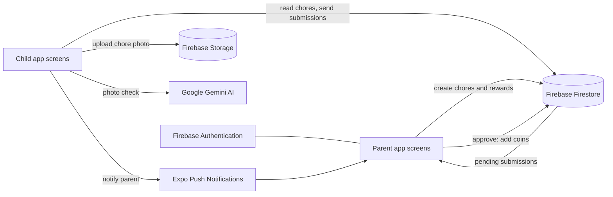

# ChorePal


ChorePal is a mobile app that helps parents and children manage household chores together.
Parents create chores and rewards. Children complete chores, take a photo as proof and earn
coins, which they spend on rewards their parents set up. An AI photo check helps parents
review submissions, and Pal, the ChorePal clipboard mascot, cheers children on.

## Team Information

**Team Name:** Eagles

**Team Members:**
- Isaac Lindsay
- Doreen Lobe
- Adam Jabbar
- Cole Brooks
- Samuel Angulo

**Course Staff:**
- Professor: Diana Rabah
- TA:

What each team member worked on is listed in [CONTRIBUTIONS.md](CONTRIBUTIONS.md).

---

## How to Run the App

1. Install dependencies:
   ```bash
   npm install
   ```
2. Copy `.env.example` to `.env`, then replace `your_gemini_api_key_here` with a Gemini API key.
   This key powers the AI photo check.
3. Start the app:
   ```bash
   npx expo start
   ```
4. Scan the QR code with **Expo Go** on your phone, or press `a` (Android emulator) or `i` (iOS simulator).

If the app shows old code after pulling changes, restart with a cleared cache: `npx expo start -c`.

---

## Where Everything Is

ChorePal is built with **Expo / React Native** (frontend) and **Firebase** (backend). Expo Router
requires every screen to live in the `app/` folder, so the folders follow Expo's standard layout
instead of separate `Frontend` and `Backend` folders. This table shows which folder covers each part
of the system.

| Part of the system | Where it is |
|---|---|
| **Main application code** | `app/`, `components/`, `utils/`, `config/` |
| **Frontend: pages / screens** | `app/` (one file per screen) |
| **Frontend: reusable components** | `components/` |
| **Frontend: images and animations** | `assets/images/` |
| **Backend: server and database** | Firebase (Firestore database, Storage for photos, Authentication). Connection in `config/firebase.ts`; data logic in `utils/` |
| **Database-related code** | `utils/choreModel.ts`, `utils/deleteFamilyData.ts`, `utils/dataRetention.ts`, `utils/uploadPhoto.ts`, `utils/photoCleanup.ts` |
| **AI component** | `utils/visionApi.ts` (Google Gemini checks chore photos) |
| **Documentation** | `user-manual.md`, `manual-privacy-section.md` |
| **Testing** | `Testing/` (test cases and results) |
| **Contributions** | `CONTRIBUTIONS.md` |

### Folder by folder

```
ChorePal/
├── app/                 Every screen in the app (Expo Router: file name = screen route)
├── components/          Reusable UI pieces shared by many screens
├── utils/               App logic: database, photos, notifications, AI, themes, chore schedules
├── config/              Firebase connection setup
├── assets/images/       Logo, icons, screenshots used in the manual, confetti animation
├── constants/, hooks/   Colors and helpers from the Expo starter template
├── scripts/             Expo starter script (not used by ChorePal)
├── user-manual.md       User manual
├── manual-privacy-section.md   Privacy section of the manual
├── app.json             App name, icons and Expo settings
├── package.json         Dependencies and run commands
└── .env.example         Template for the API key file
```

### `app/`: screens

| Area | Files | What they do |
|---|---|---|
| Start | `index.tsx`, `_layout.tsx` | Welcome screen; `_layout` lists every screen and the navigation |
| Parent sign in | `parent-login.tsx`, `sign-up.tsx` | Parent login and account creation (with email verification) |
| Parent home | `parent-dashboard.tsx` | Overview of the family's children, chores and progress |
| Children | `add-child.tsx`, `child-details.tsx`, `family-code.tsx` | Add a child, view a child, show the code a child uses to log in |
| Chores | `create-chore.tsx`, `chore-list.tsx` | Create/edit chores (one-time, daily or weekly) and see every child's chores |
| Approvals | `approvals.tsx`, `approval-detail.tsx` | Review a child's photo and approve or reject it |
| Rewards | `create-reward.tsx`, `rewards-list.tsx` | Create rewards and manage the reward list |
| Discipline | `discipline.tsx` | Coin deductions for a child |
| Parent settings | `settings.tsx`, `set-home.tsx`, `privacy-policy.tsx` | Account, notifications, AI photo check, home location, privacy policy |
| Child sign in | `child-login.tsx` | Child logs in with the family code |
| Child home | `child-dashboard.tsx` | Today's chores, missed chores, photo upload, Pal the mascot |
| Child pages | `child-calendar.tsx`, `child-rewards.tsx` | Chore calendar; spend coins on rewards |
| Child settings | `child-settings.tsx`, `child-theme.tsx`, `child-notifications.tsx`, `child-help.tsx` | Themes, notifications and home location, help |
| Not used | `(tabs)/`, `modal.tsx` | Left over from the Expo starter template |

### `components/`: reusable pieces

| File | What it does |
|---|---|
| `PressableScale.tsx` | Button that shrinks slightly when pressed (used on most screens) |
| `AnimatedEntry.tsx` | Fades and slides content in when a screen opens |
| `FloatingBackground.tsx` | Themed background pictures and floating items on child screens |
| `PalMascot.tsx` | Pal, the clipboard mascot, whose mood and colors follow progress and theme |
| `Celebration.tsx` | Confetti when a chore is submitted |
| `TextToSpeech.tsx` | Reads text aloud for younger children |
| `external-link.tsx`, `hello-wave.tsx`, `parallax-scroll-view.tsx`, `themed-*.tsx`, `ui/` | Expo starter template files |

### `utils/`: logic and backend code

| File | What it does |
|---|---|
| `choreModel.ts` | Creating, deleting and cleaning up chores in the database (one chore per child) |
| `choreSchedule.ts` | Works out when a chore is due (one-time, daily, weekly) and whether it is done or overdue |
| `uploadPhoto.ts`, `photoCleanup.ts` | Upload chore photos to Firebase Storage and delete them later |
| `deleteFamilyData.ts` | Deletes a child's or a whole family's data |
| `dataRetention.ts` | Automatically clears old photos and records |
| `notifications.ts` | Push notifications (Expo push service) |
| `useHomeGeofence.ts` | Detects when a child arrives home, for chore reminders |
| `visionApi.ts` | AI photo check with Google Gemini |
| `childTheme.ts` | Color themes for the child screens |

---

## How the Parts Connect



1. A **parent** signs up (Firebase Authentication) and adds children. Each child gets a family code.
2. The parent creates **chores** and **rewards**, which are saved in **Firestore**.
3. A **child** logs in with the family code and sees their chores for today.
4. The child takes a photo. It is uploaded to **Firebase Storage**, and **Gemini AI** checks
   whether the chore looks done (parents can turn this off).
5. A submission is saved in Firestore and the parent gets a **push notification**.
6. The parent approves or rejects it in **Approvals**. Approving adds coins to the child,
   which the child can spend on rewards.

---

## Testing

All testing documents are in the [`Testing/`](Testing/README.md) folder:

- **Test cases:** [Acceptance Test Procedure (ATP)](Testing/Test_Cases/ChorePal_ATP.md): 9 test cases with steps, expected and actual results, and screenshots.
- **Test results:** [User Acceptance Testing (UAT) Report](Testing/Test_Results/ChorePal_UAT_Report.md): 10 scenarios tested by two other teams. All passed, with full acceptance from the client.

## Documentation

- [User Manual](user-manual.md)
- [Privacy section of the manual](manual-privacy-section.md)
