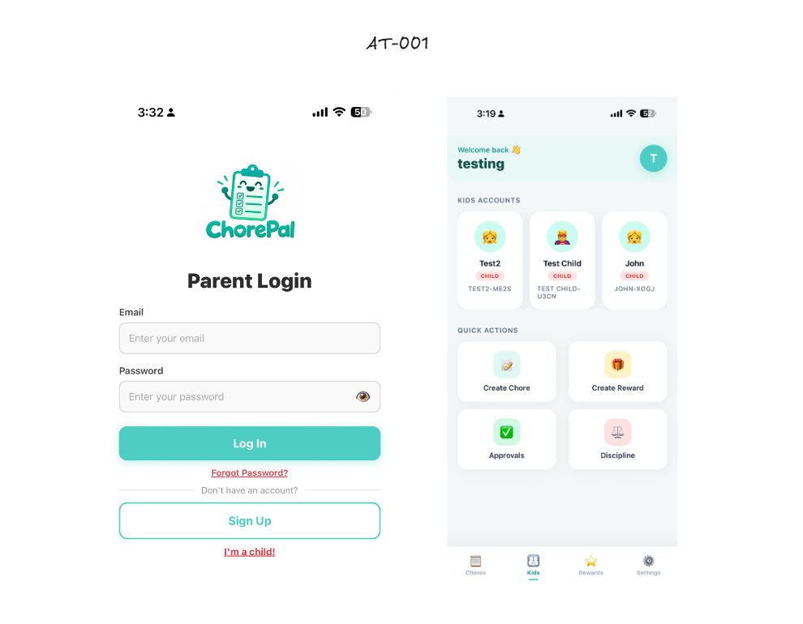
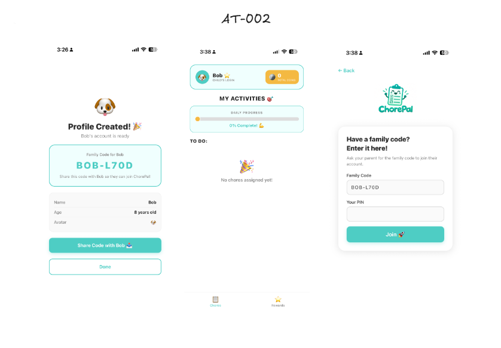
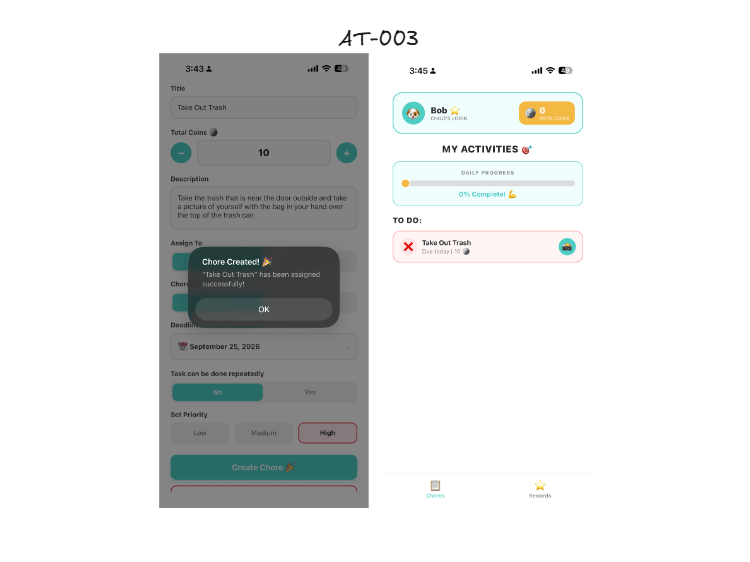
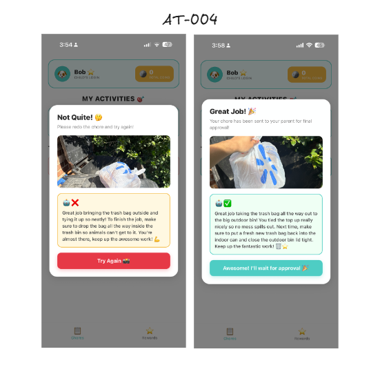
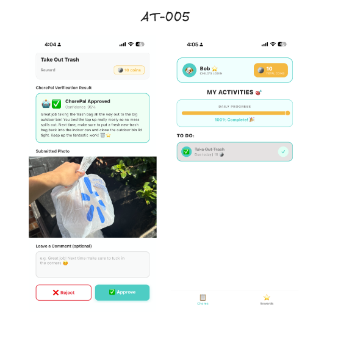
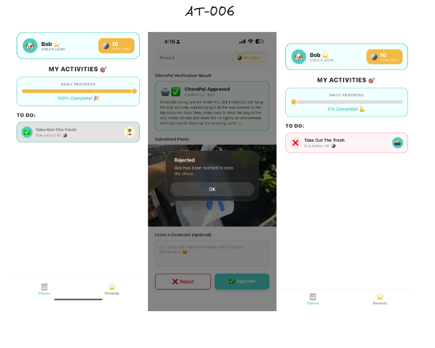
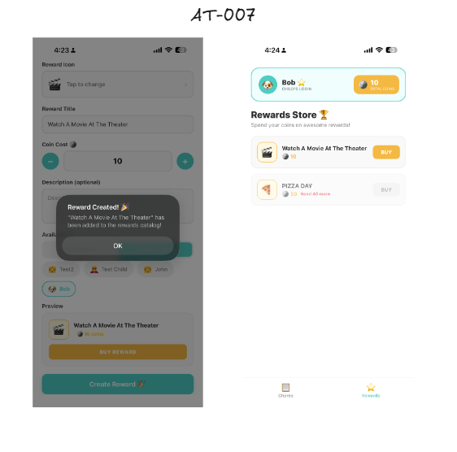
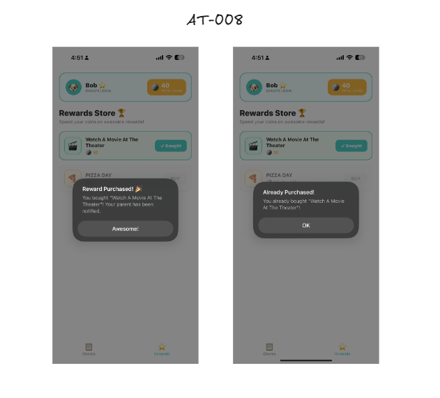
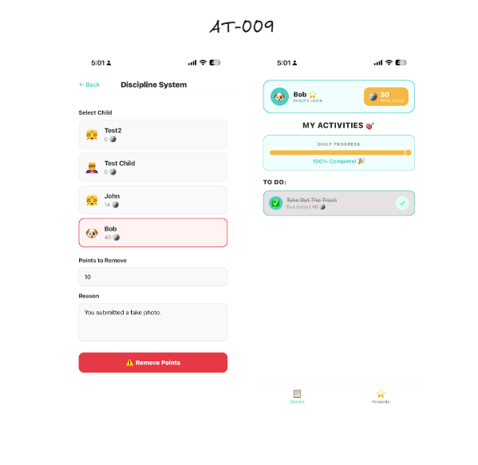

# ChorePal: Acceptance Test Procedure (ATP)

**Team 2:** Sam Angulo · Doreen Lobe · Isaac Lindsay · Cole Brooks · Adam Jabbar
**University of North Texas** · September 24, 2026 · Version 1.0

> This is a readable copy of [ChorePal_ATP.pdf](ChorePal_ATP.pdf). The PDF is the signed original.

---

## 1. Purpose

This document outlines the acceptance testing process for the ChorePal mobile application. The purpose of
this ATP is to verify that the main features and requirements of ChorePal are working correctly before the
application is delivered for User Acceptance Testing. Testing will focus on features such as chore
management, parent and child accounts, rewards, and the ChorePal AI verification system.

## 2. Scope

### 2.1 In-Scope

| Item | Description |
|---|---|
| 1 | User Accounts and Authentication |
| 2 | Chore Assignment and Management |
| 3 | Chore Viewing and Completion |
| 4 | ChorePal AI Photo Verification |
| 5 | Parent Approval Workflow |
| 6 | Points and Reward System |
| 7 | Progress and Chore Updates |
| 8 | Mobile Application and Firebase Backend |

### 2.2 Out-of-Scope

| Item | Description / Reason |
|---|---|
| 1 | AI awarding points automatically: points are only awarded after the parent approves the completed chore. |
| 2 | Real payment transactions: ChorePal uses virtual points and rewards only. |
| 3 | Android testing: current acceptance testing is focused on iOS 15+ using Expo Go. |
| 4 | Website / desktop version: ChorePal is being tested as a mobile application. |
| 5 | AI-generated rewards: parents create rewards, and children use their earned points to redeem them. |

### 2.3 Non-Functional Scope

| NFR ID | Description |
|---|---|
| NFR-001 | Performance: app response time of 3–5 seconds and ChorePal AI verification within 1–2 minutes. |
| NFR-002 | Usability: child-friendly interface with simple navigation and clear feedback/error messages. |
| NFR-003 | Security: secure authentication and protection of parent and child account information. |
| NFR-004 | Reliability: core ChorePal features should operate without crashing or losing user data. |
| NFR-005 | Compatibility: ChorePal should function correctly on iOS 15+ using Expo Go. |

## 3. Test Environment

| Component | Details |
|---|---|
| Application | ChorePal (React Native / TypeScript) |
| Platform / OS | iOS 15+ (device and/or Simulator) |
| Backend | Google Firebase |
| AI Service | Google Gemini API |
| Network | Wi-Fi / cellular (HTTPS) |
| Test Devices | iPhone(s) with Expo Go installed and the current ChorePal build |
| Test Date | 9/25/26 |

## 4. Acceptance Criteria

- All in-scope functional requirements have passing test cases
- Gemini verification accuracy ≥ 85% with descriptive feedback
- Parent approval required before points are awarded
- No Critical or High severity defects remain open
- Users are able to successfully log in and access the correct parent or child account
- Parents are able to create and assign chores, and children can view and complete assigned chores
- The points and rewards systems update balances correctly after chore completion is approved
- The Discipline System correctly removes points from a selected child
- Core features function without crashing or loss of data during testing
- ChorePal works correctly on the iPhone/Expo Go test environment

## 5. Acceptance Test Cases

| Test ID | Req / Feature | Test Steps | Expected Result | Actual Result | P/F |
|---|---|---|---|---|---|
| AT-001 | Parent Login | 1. Open app 2. Enter valid credentials 3. Tap Login | Parent logs in using valid credentials and sees their parent dashboard. | I opened the app, entered the valid credentials in the parent login and it successfully sent me to the parent dashboard. | **PASS** |
| AT-002 | Account Linking | 1. Parent creates child account 2. Log out and log in as child with valid credentials | A child account is created; with those credentials the child is able to log in using their code and successfully view their child dashboard. | I successfully created a child account as a parent. I logged out and used those credentials that were generated to log in as the child. I was then able to see the child dashboard. | **PASS** |
| AT-003 | Chore Assignment | 1. As the parent, create a chore filling in all empty fields 2. Assign the chore 3. As the child, the chore should show up on the child dashboard | Chore is created successfully and appears on the child dashboard with a due date. | I successfully created a chore as the parent and assigned it to the child. I logged in as the child and was able to see that same chore in my dashboard. | **PASS** |
| AT-004 | ChorePal Verification | 1. As the child, upload an incomplete chore photo 2. Upload a complete chore photo as a child 3. Submit for ChorePal Verification 4. Analyze results | ChorePal verification returns complete/incomplete results 85% of the time with descriptive feedback. | I uploaded an incomplete chore photo 5 times, and a complete chore photo 5 times. It only failed once, as ChorePal Verification was successful 90% of the time. Descriptive feedback was provided every time. | **PASS** |
| AT-005 | Parent Notification & Approval of Points | 1. As the child, submit a complete verified photo 2. Parent account receives notification 3. As the parent, approve the chore 4. As the child, check to see if coins are received and chore is marked as complete | Parents are notified that ChorePal Verification approved the child's chore. After parent approval, the child receives points and chore status is complete. | When the child submitted the complete chore, the parent failed to get the notification as I received a notification error in logs. However, as shown in the screenshot, the child's chore was still able to be approved and coins were rewarded to the child successfully. | **FAIL** |
| AT-006 | Child Notification | 1. As the parent, reject a submitted chore 2. Child account then receives notification | Chores remain incomplete; the child is notified that the chore submission was rejected by the parent. | The child dashboard showed that a chore was pending parent approval. I then logged into the parent account and rejected the approval; the system failed to send a notification to the child. However, it changed the chore back to incomplete to allow the child to redo the chore. | **FAIL** |
| AT-007 | Parent Create Reward | 1. As the parent, create a reward for the child 2. Log in to child account and check if reward is in the rewards screen | Parents are able to create the reward. The child account should see that reward available on their screen. | In the parent account I was successfully able to create a reward for the child account. I then logged in as the child and was able to see that exact reward in my reward store. | **PASS** |
| AT-008 | Reward Purchase | 1. As the child, purchase a reward on child account 2. Reward on reward screen is then marked as redeemed | On the child account, the child with sufficient points should be able to purchase a reward; the reward should be marked as redeemed afterwards. | On the child account I purchased a reward with sufficient funds; it didn't allow me to purchase chores that I didn't have sufficient funds on. It then marked the reward as redeemed as well as deducted the necessary funds from the child account. | **PASS** |
| AT-009 | Discipline System | 1. As the parent, go to discipline system 2. Remove coins from child and add reason 3. Log in to child account 4. Check to see if coins are removed and look at reason why they were removed | The parent should be able to remove as many coins as they want from a child as well as add reasoning. The child account should have those coins taken away as well as be able to see the reasoning. | As a parent I deducted 10 points using the discipline system and added a reason. I logged into the child account and noticed the points were successfully deducted; however, each test I did never sent the child the reasoning. | **FAIL** |

### Screenshots

| Test | Screenshot |
|---|---|
| AT-001 Parent Login |  |
| AT-002 Account Linking |  |
| AT-003 Chore Assignment |  |
| AT-004 ChorePal Verification |  |
| AT-005 Parent Notification & Approval |  |
| AT-006 Child Notification |  |
| AT-007 Parent Create Reward |  |
| AT-008 Reward Purchase |  |
| AT-009 Discipline System |  |

## 6. Defects Found

| Defect ID | Issue Description | Severity | Status |
|---|---|---|---|
| D-001 | The parent is not receiving a push notification when the child submits a chore that is verified to be complete by ChorePal Verification. Parent approval is still working. | Medium | Open |
| D-002 | The child is not receiving a notification when the parent rejects a chore submission. It still correctly reverts to incomplete. | Medium | Open |
| D-003 | The discipline system is deducting points correctly but is not displaying the reason to the child account. | Medium | Open |

## 7. Test Summary

| Metric | Value |
|---|---|
| Total Test Cases | 9 |
| Passed | 6 |
| Failed | 3 |
| Pass Rate | 66.7% |

## 8. Client / Stakeholder Acceptance

| Field | Details |
|---|---|
| Stakeholder Name | Diana Rabah |
| Role / Organization | Professor Diana Rabah |
| Comments | Higher pass rate for all tests is needed |
| Acceptance Status | ☐ Accepted ☐ Accepted with Minor Issues ☐ Rejected |
| Signature | Diana Rabah |
| Date | 9/27/2026 |

## 9. Roles and Responsibilities

| Team Member | Role | Responsibility |
|---|---|---|
| Sam Angulo | Test Lead / Coordinator | Oversee ATP, compile report |
| Doreen Lobe | Tester | Execute assigned test cases, record actual results |
| Isaac Lindsay | Tester | Execute client and stakeholder experience/roles and responsibilities |
| Cole Brooks | Developer / Defect Owner | Fix defects found during ATP |
| Adam Jabbar | Tester / Environment | Run test cases and report bugs |

*This template is based on ChorePal SRS Version 2.0.*
